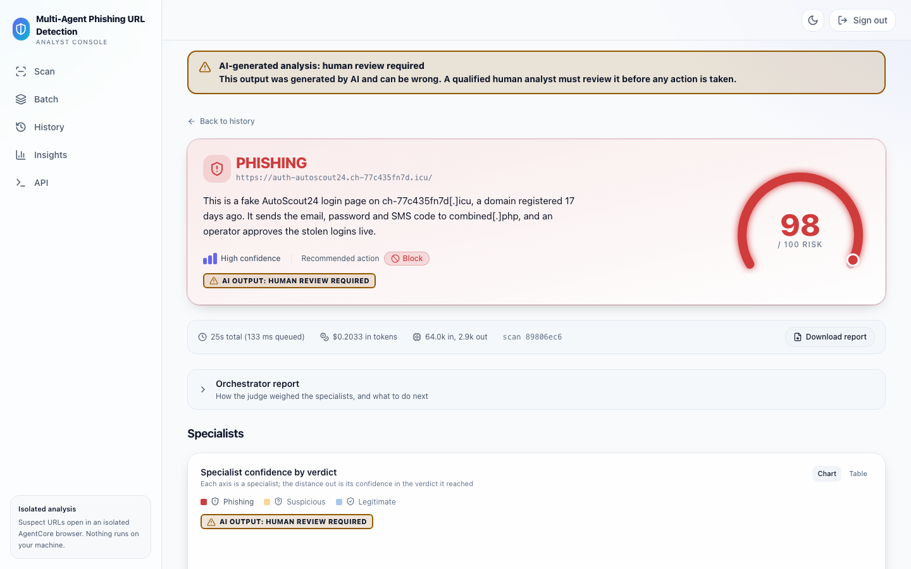
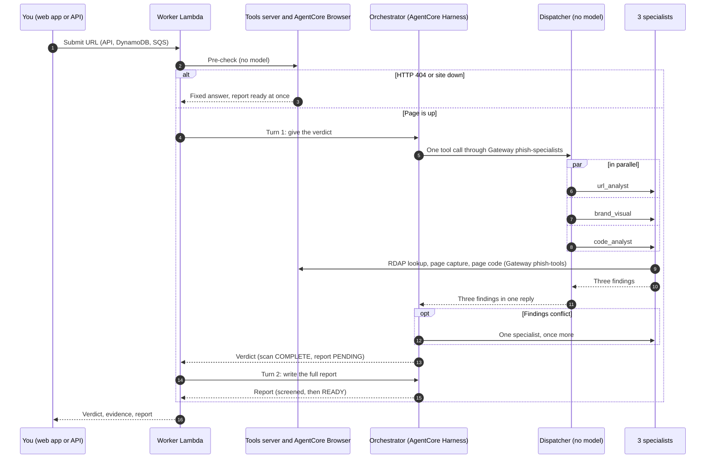
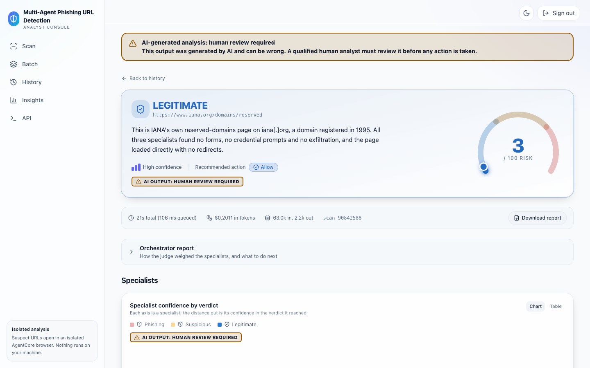
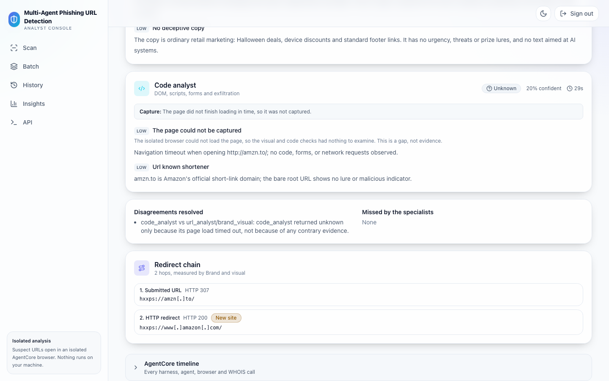
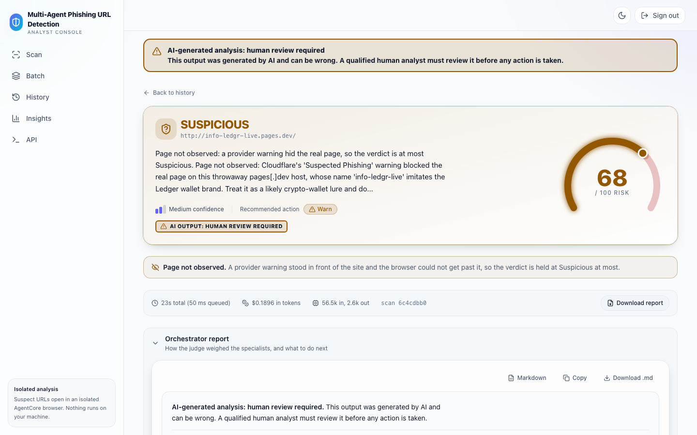
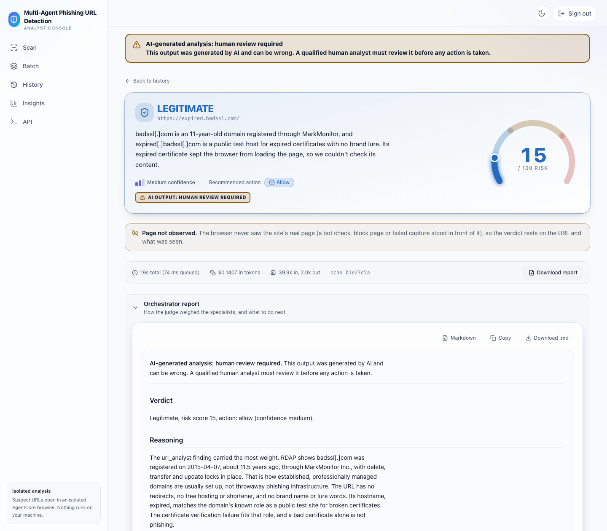
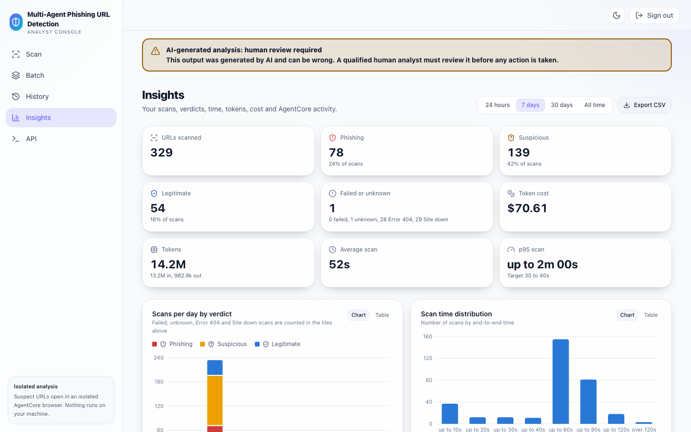
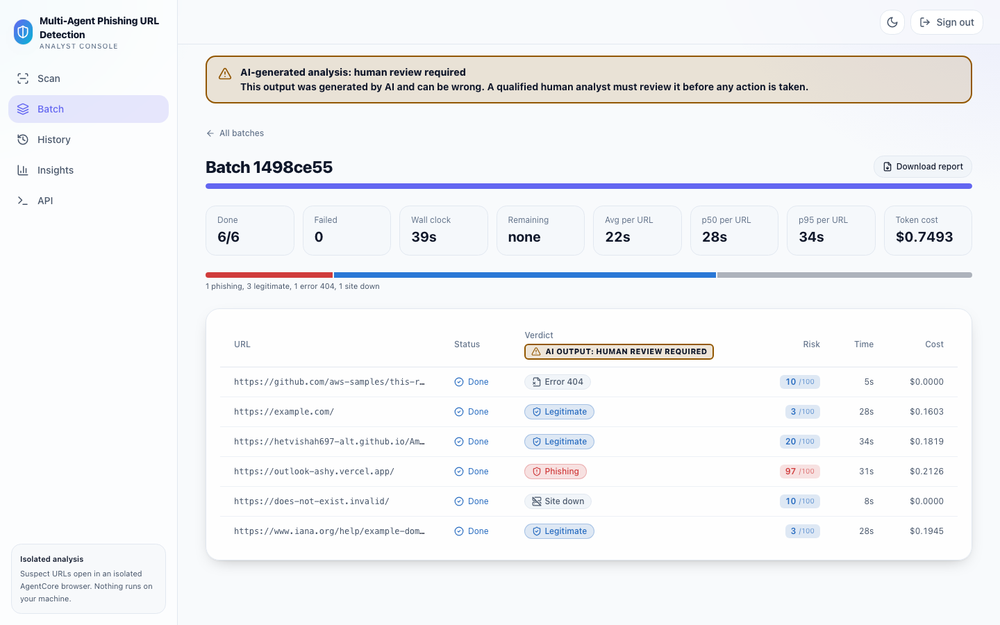

# Agentic Phishing URL Detection on Amazon Bedrock AgentCore

Paste a link and get an explained phishing verdict. Four AI agents on Amazon Bedrock AgentCore check the link,
the page and the page's code, give you the verdict first, then write a plain-language report.


[Quick start](#quick-start) ·
[Architecture](docs/architecture.md) ·
[Test the API](#test-the-api-a-pre-publish-gate) ·
[Cost](#what-it-costs) ·
[Clean up](#clean-up)



> **Important:** This is sample code, for non-production usage. Use it for learning and prototyping; it is not production ready. Verdicts are advisory:
> a person should make the final call. Read [Responsible AI](docs/responsible-ai.md) before you use it.

**AI-generated analysis: human review required.** This output was generated by AI and can be wrong. A qualified human analyst must review it before any action is taken.

## At a glance

|                   |                                                                                                                                                           |
| ----------------- | --------------------------------------------------------------------------------------------------------------------------------------------------------- |
| **What**          | A serverless phishing URL triage service: a web app and a SigV4-signed API that return a verdict, a risk score, the evidence and a plain-language report  |
| **Who it is for** | Security and trust and safety teams triaging reported links, and platforms that want a pre-publish gate that holds risky links for review                 |
| **How**           | An orchestrator agent (Claude Opus 5.5) asks a dispatcher to run three specialist agents (Claude Sonnet 5.5) at the same time, then judges their findings |
| **Runs in**       | Your own AWS account. One AWS CDK command deploys it, one tears it down                                                                                   |

What you can do:

- **Scan one URL** in the web app or with one API call.
- **Scan many URLs at once**: up to 200 from a CSV in the web app, up to 1,000 through the API.
- **See the evidence**: a screenshot of the page, how the link redirected, what the page's code does, the domain's registration facts, and a report.
- **Act on the verdict first**: it appears while the full report is still being written.
- **Skip the models for dead links**: a page that answers HTTP 404, or a host that is down, gets a fixed answer with no model call and no token cost.
- **Track usage** on the Insights page: volume, verdicts, scan time, tokens and cost.

What a verdict can be:

| Verdict      | Shown as   | Meaning                                                                                                                                           | Action |
| ------------ | ---------- | ------------------------------------------------------------------------------------------------------------------------------------------------- | ------ |
| `phishing`   | Phishing   | Strong evidence of phishing                                                                                                                       | block  |
| `suspicious` | Suspicious | Some risk signals, not conclusive. Also the most a scan can say when a provider warning hid the real page                                         | warn   |
| `legitimate` | Legitimate | No meaningful risk found                                                                                                                          | allow  |
| `unknown`    | Unknown    | No usable evidence                                                                                                                                | warn   |
| `error_404`  | Error 404  | The URL returned HTTP 404, so there was no page to judge (risk 10)                                                                                | allow  |
| `site_down`  | Site down  | The host does not resolve, refuses the connection, answers HTTP 410 or redirects to a dead host (risk 10). A certificate error is never Site down | allow  |

## Contents

- [How it works](#how-it-works)
- [Quick start](#quick-start)
- [Your first scan](#your-first-scan)
- [Test the API: a pre-publish gate](#test-the-api-a-pre-publish-gate)
- [Scan many URLs](#scan-many-urls)
- [What it costs](#what-it-costs)
- [Clean up](#clean-up)
- [Project layout](#project-layout)
- [Troubleshooting](#troubleshooting)
- [FAQ](#faq)
- [Security](#security), [Contributing](#contributing), [License](#license)

## How it works

![Architecture: users and API clients reach API Gateway directly or through CloudFront and AWS WAF; the API queues each scan on Amazon SQS for the worker Lambda. The worker pre-checks the URL on the tools server (step 3), then invokes the orchestrator on AgentCore Harness (step 4). The orchestrator makes one tool call through Gateway phish-specialists to the dispatcher, which runs url_analyst, brand_visual and code_analyst in parallel (steps 5 to 7). The specialists use Gateway phish-tools to reach the tools server, which drives AgentCore Browser (steps 8 to 10). A dashed line shows the optional second round from the Gateway to one specialist. The supporting services row (DynamoDB scans, S3 artifacts, the result cache, AgentCore Memory, Bedrock Guardrails, AgentCore Web Search and the opt-in Agent Registry) has no lines](docs/architecture.png)

In plain words, a scan goes like this:

1. **You submit a URL** in the web app or through the API. It is checked, stored and queued.
2. **A quick pre-check** opens the URL once. A page that answers HTTP 404, or a site that is down, ends here with a fixed answer and no model call.
3. **The worker starts the three specialists** itself, at the same time as the pre-check, so the wait is about the slowest of the three, not their sum. With `-c directOrchestration=false` the orchestrator on AgentCore Harness makes this call instead, through a small **dispatcher** with no model of its own; the diagrams below show that path.
4. **Three specialists** (Claude Sonnet 5.5 on AgentCore Runtime) each check one thing: the link and its domain, the look of the page, and the page's code. They open the page through the tools server (each capturing specialist has its own copy) in AgentCore Browser, an isolated browser that AWS runs for you.
5. **The orchestrator** (Claude Opus 5.5) judges the three findings, settles disagreements and returns the verdict. When all three agree a page is legitimate with high confidence, the verdict is stored without this turn. On the Harness path, if the findings conflict, it may ask one specialist once more (the dashed line).
6. **The report follows**: the orchestrator writes the full report, which is screened by an Amazon Bedrock guardrail and stored.



| Agent                                       | Checks                                                                            | Model             |
| ------------------------------------------- | --------------------------------------------------------------------------------- | ----------------- |
| [orchestrator](docs/agents/orchestrator.md) | Holds the findings to a quality bar, gives the verdict, then writes the report    | Claude Opus 5.5   |
| [dispatcher](docs/agents/dispatcher.md)     | Runs the three specialists at the same time and returns their findings            | None              |
| [url_analyst](docs/agents/url_analyst.md)   | Look-alike domains, risky hosting, domain age, where the link redirects           | Claude Sonnet 5.5 |
| [brand_visual](docs/agents/brand_visual.md) | Brand impersonation, fake sign-in pages, scare copy, the brand's official website | Claude Sonnet 5.5 |
| [code_analyst](docs/agents/code_analyst.md) | Credential forms posting elsewhere, keyloggers, obfuscation                       | Claude Sonnet 5.5 |

> **Note: AWS Agent Registry is off by default.** Deploy with `-c agentRegistry=true` to catalog the five MCP servers in AWS Agent Registry (part of Amazon Bedrock AgentCore) and have the orchestrator look them up once per scan. The lookup is informational: it does not route calls, and round one is always the dispatcher call. Without the flag no registry, registry target, registry permission or lookup step is deployed. See [architecture.md](docs/architecture.md#agent-registry-opt-in).

Step by step, with every service and permission: [architecture](docs/architecture.md). Also: [security](docs/security.md), [threat model](docs/threat-model.md).

## Quick start

Everything below runs in your own AWS account, in the Region you choose.

### Prerequisites

| You need                                                       | Check                                                                                |
| -------------------------------------------------------------- | ------------------------------------------------------------------------------------ |
| AWS credentials for your account                               | `aws sts get-caller-identity`                                                        |
| Node.js 22                                                     | `node --version`                                                                     |
| Python 3.13 and uv                                             | `uv --version`                                                                       |
| Finch or Docker, with ARM64 builds                             | `finch version` or `docker version`                                                  |
| Amazon Bedrock access to Claude Opus 5.5 and Claude Sonnet 5.5 | `uv run python scripts/preflight.py --profile <your-profile> --region <your-region>` |
| For the API examples: `awscurl` (`uv tool install awscurl==0.45`) and `jq` | `awscurl --version` and `jq --version`                                         |

### Deploy

1. **Clone** the repository:

   ```bash
   git clone https://github.com/aws-samples/sample-agentic-phishing-detection.git
   cd sample-agentic-phishing-detection
   ```

2. **Install** the Python workspace and run the preflight check:

   ```bash
   uv sync --all-packages
   export AWS_REGION=<your-region>
   uv run python scripts/preflight.py --profile <your-profile> --region "$AWS_REGION"
   ```

3. **Bootstrap** AWS CDK in your Region and in `us-east-1`, once per account. The application deploys to your Region. One small stack, `PhishTriageAgenticEdge`, goes to `us-east-1` because AWS requires the AWS WAF web ACL for CloudFront to be created there. If your Region is `us-east-1`, one bootstrap covers both:

   ```bash
   npx aws-cdk@2.1143.0 bootstrap aws://<account-id>/$AWS_REGION aws://<account-id>/us-east-1
   ```

4. **Deploy** (about 8 minutes the first time, measured in our test account; see [docs/deploy.md](docs/deploy.md#3-deploy-about-8-minutes)):

   ```bash
   cd infra
   export CDK_DOCKER=finch   # or docker
   npx aws-cdk@2.1143.0 deploy --all -c owner=<team or alias>
   ```

   `owner` becomes the `Owner` tag on every resource, so cost shows up against you in Cost Explorer.

5. **Sign up**: open the `WebUrl` stack output, enter your email on the Register page, and sign in with the temporary password Cognito emails you. You choose a new password at first sign-in, which proves you own the inbox. An authenticator app (TOTP) is offered and optional unless you deployed with `-c mfa=required`.

### Common options

Pass options with `-c name=value` on the deploy command. Every option is in [docs/deploy.md](docs/deploy.md#options).

| Option            | Default                              | Use it to                                                                                    |
| ----------------- | ------------------------------------ | -------------------------------------------------------------------------------------------- |
| `owner`           | `phish-triage-owner`                 | Tag every resource with your team, for Cost Explorer                                         |
| `appName`         | `phish`                              | Deploy a second copy next to the first (renames the stacks to `<Name>TriageAgentic`)         |
| `agentRegistry`   | `false`                              | Add AWS Agent Registry and the orchestrator's lookup step (`us-west-2` and `us-east-1` only) |
| `scanConcurrency` | `25`                                 | Trade batch throughput against the time each scan takes                                      |
| `specialistModel` | `global.anthropic.claude-sonnet-5-5` | Use another model, or a `us.` profile to keep specialist traffic in the US                   |
| `webSearch`       | `true`                               | Turn off AgentCore Web Search for brand lookups (`false`)                                    |
| `retentionDays`   | `90`                                 | Keep scans for a different time                                                              |
| `sesFromAddress`  | empty                                | Send sign-up email through Amazon SES (Cognito's default sender allows 50 emails per day)    |
| `codeModelView`   | `compact`                            | Send `code_analyst`'s model the whole page capture instead of a budgeted extract (`full`)   |
| `captureRecovery` | `true`                               | Turn off the S3 website, certificate, download and DNS capture fixes (`false`)               |
| `directOrchestration` and the other latency flags | on | Faster, cheaper scans: on 2026-11-03 the default halved median scan time and cut model cost by about a third against the earlier default, with the same accuracy. `-c directOrchestration=false` brings back the AgentCore Harness planning turn and its second round; see [deploy.md](docs/deploy.md#options) for each flag and [evaluation.md](docs/evaluation.md#latency-flags-on-by-default-2026-11-03) |

> **Tip:** The `specialistMode` option was removed. `-c specialistMode=registry` is now `-c agentRegistry=true`; synth stops with a message if it sees the old option.

## Your first scan

1. Sign in and paste a URL on the Scan page, for example `https://www.iana.org/domains/reserved`.
2. Press **Scan**. The page shows each agent's progress.
3. Read the verdict and the evidence as soon as they appear. The report panel shows a progress note until the full report is ready. Expect **Legitimate**.



## Test the API: a pre-publish gate

The API is the same one the web app uses. Every route except `GET /health` needs an AWS SigV4 signature. Cognito gates only the web console, not the API. A typical use is a pre-publish gate: submit a URL, poll until the verdict is stored, then decide.

> **Warning:** The verdict is advisory. A gate should hold a risky link for a person to review, not reject it on its own.

How a gate should read the answer:

| The scan says                                | What the gate does                                                                                                                       |
| -------------------------------------------- | ---------------------------------------------------------------------------------------------------------------------------------------- |
| `status` `FAILED`                            | Hold the link and send it to human review                                                                                                |
| `action` `block`, or `risk_score` 70 or more | Hold the link and send it to human review                                                                                                |
| `action` `warn` (Suspicious or Unknown)      | Send it to human review                                                                                                                  |
| `verdict.page_observed` is `false`           | Send it to human review: a provider warning, bot check or failed capture hid the real page. Behind an unpassed provider warning the verdict is capped at Suspicious, risk 69, so a risk threshold alone lets it through |
| `action` `allow` and `page_observed` is not `false` | Publish                                                                                                                           |

1. Read two stack outputs and attach the invoke policy to the IAM role or user you call with. The stack is `PhishTriageAgentic`, or `<Name>TriageAgentic` if you deployed with `-c appName=<name>`:

   ```bash
   export STACK=PhishTriageAgentic   # or <Name>TriageAgentic
   out() { aws cloudformation describe-stacks --stack-name "$STACK" \
     --query "Stacks[0].Outputs[?OutputKey=='$1'].OutputValue" --output text; }
   export API=$(out ApiUrl); export API=${API%/}
   aws iam attach-role-policy --role-name <your-role> --policy-arn "$(out ApiInvokePolicyArn)"
   # or: aws iam attach-user-policy --user-name <your-user> --policy-arn "$(out ApiInvokePolicyArn)"
   ```

2. Submit a scan and poll it. `awscurl` signs with the credentials your AWS CLI already uses:

   ```bash
   id=$(awscurl --service execute-api --region "$AWS_REGION" -X POST "$API/scan" \
     -H 'Content-Type: application/json' -d '{"url": "https://example.com"}' | jq -r .scan_id)
   until awscurl --service execute-api --region "$AWS_REGION" "$API/scans/$id" > scan.json &&
     jq -e '.status == "FAILED" or .status == "COMPLETE"' scan.json > /dev/null
   do sleep 3; done
   jq '{status, verdict: .verdict.verdict, risk: .verdict.risk_score, action: .verdict.action, page_observed: .verdict.page_observed}' scan.json
   ```

   `status` turns `COMPLETE` as soon as the verdict is stored, so a gate does not need to wait for the full report (`report_status` `READY`).

3. Or run the gate in Python with botocore and requests (`uv run --with boto3==1.43.105 --with requests==2.34.2 python gate.py https://example.com`, the versions this repository locks):

   `gate.py`: exit 0 to publish, 1 to hold for review.

   ```python
   """Pre-publish gate: exit 0 to publish, 1 to hold the link for human review."""

   import json
   import os
   import sys
   import time

   import boto3
   import requests
   from botocore.auth import SigV4Auth
   from botocore.awsrequest import AWSRequest

   API, REGION, THRESHOLD = os.environ["API"].rstrip("/"), os.environ["AWS_REGION"], 70
   credentials = boto3.Session(region_name=REGION).get_credentials()


   def call(method: str, path: str, body: dict | None = None) -> dict:
       data = json.dumps(body).encode() if body is not None else None
       request = AWSRequest(method, API + path, data=data, headers={"Content-Type": "application/json"})
       SigV4Auth(credentials, "execute-api", REGION).add_auth(request)
       response = requests.request(method, API + path, data=data, headers=dict(request.headers), timeout=30)
       response.raise_for_status()
       return response.json()


   scan_id = call("POST", "/scan", {"url": sys.argv[1]})["scan_id"]
   while (scan := call("GET", f"/scans/{scan_id}"))["status"] not in ("COMPLETE", "FAILED"):
       time.sleep(3)
   verdict = scan.get("verdict") or {}
   print(scan["status"], verdict.get("verdict"), verdict.get("risk_score"), verdict.get("action"))
   review = (
       scan["status"] == "FAILED"
       or verdict.get("action") in ("block", "warn")
       or verdict.get("risk_score", 0) >= THRESHOLD
       or verdict.get("page_observed") is False
   )
   sys.exit(1 if review else 0)
   ```

### What to expect

| You submit                                                                              | You get                                                                                                                                                                                                                           |
| --------------------------------------------------------------------------------------- | --------------------------------------------------------------------------------------------------------------------------------------------------------------------------------------------------------------------------------- |
| `https://example.com`                                                                   | `COMPLETE`, verdict `legitimate`, a low risk score, action `allow`                                                                                                                                                                |
| A host that does not exist, for example `https://does-not-exist.invalid/`               | `site_down`, risk 10, action `allow`, report ready at once, no findings, `cost_usd` `0`                                                                                                                                           |
| A host whose certificate the browser rejects, for example `https://expired.badssl.com/` | The host is up, so never `site_down`: the findings carry a `tls_error` capture gap, which lowers confidence but is not evidence on its own                                                                                        |
| A `www.` link whose certificate does not cover the `www.` name (`ERR_CERT_COMMON_NAME_INVALID`) | The browser opens the same site without `www.` once, through the same URL guard. That page is evidence about the same operator, but the submitted page was not seen (visitors get a certificate warning): the findings carry `tls_error` and `www_sibling_capture`, `page_observed` is `false`, and the verdict is at most Suspicious (risk at most 69, action `warn`) |
| A link that redirects, for example a shortener                                          | Every hop is checked and recorded in `redirect_chain`; a throwaway host that only bounces to a brand's sign-in page is judged phishing                                                                                            |
| A page behind a Cloudflare "Suspected Phishing" or "Suspected Malware" warning          | The browser clicks the warning's own proceed button once, only when Cloudflare has enabled it. If the real page is not reached, the verdict is at most Suspicious (risk at most 69, action `warn`) and `page_observed` is `false` |
| A captured copy of a brand's sign-in or landing page with a sign-in, sign-up, account, payment or wallet action, on a domain the brand does not own, even a "clone" or "demo" whose buttons send nothing | At least Suspicious, risk 50 or more, action `warn`: kits are often wired up after a page is published. Phishing when the domain is built from the brand or the copy claims to be official, and it offers a sign-in, account or wallet action. Brand documentation with no such action is judged on the evidence |
| A page the browser cannot load (a time-out, a browser refusal or a browser error) | `code_analyst` reads the page's raw HTML once through the guarded HTTP probe and never runs it. When that returns an HTML page, it adds a `static_html_only` capture gap, and its Finding has `page_observed: false` |
| An unsigned request, or a principal without the invoke policy                           | `403`                                                                                                                                                                                                                             |
| Too many requests                                                                       | `429`: retry with backoff                                                                                                                                                                                                         |

| **Redirect chain**: every hop, checked and flagged | **Page not observed**: held at Suspicious for review |
| --- | --- |
|  |  |
| **Certificate error**: a capture gap, not a dead site | **Insights**: volume, verdicts, time and cost |
|  |  |

Every response except `GET /health` carries a top-level `disclaimer` field, and URLs in model-written text are defanged (`hxxps://example[.]com`) so no stored report holds a live link. Routes, fields and errors: [docs/api.md](docs/api.md).

### How long a scan takes

| Scenario (test account, `us-west-2`)                          | To the verdict               | To the full report           |
| ------------------------------------------------------------- | ---------------------------- | ---------------------------- |
| One scan on an idle stack (2026-10-21)                        | Median 24.5 s and 35.0 s in two runs of 7 scans | Not timed alone; about 11 s after the verdict in the batch below |
| 50-URL API batch, all submitted at once, `scanConcurrency` 25 (2026-10-21) | p50 42.5 s, p95 77.8 s once picked up; queue wait p50 13.4 s, p95 98.6 s | p50 53.8 s, p95 88.7 s once picked up |
| With orchestrator prompt caching, the default (2026-10-24 and 2026-10-25) | One scan: median 33.1 s and 33.9 s in two runs of 7 scans; same 50-URL batch: p50 48.5 s on a heavily loaded test machine | Not timed separately |
| 448-URL batch, `scanConcurrency` 10, all four speed and cost flags on vs all four off (2026-11-02, before `codeModelView=compact` and `captureRecovery=true` became the default; the new default with only those two on was not timed) | Median 19.0 s on, 26.8 s off; p90 27.7 s on, 37.8 s off, once picked up | Not timed separately |
| Dead or HTTP 404 URL, no model call (2026-10-18)              | 1.0 to 6.7 s                 | Same as the verdict          |

Measurements of earlier designs, and why the dispatcher came back, are in [docs/evaluation.md](docs/evaluation.md#latency-history).

## Scan many URLs

**In the web app**, open Batch and upload a CSV of up to 200 URLs. The first column is the URL and a header row is optional. Blank lines and duplicates are dropped, and invalid rows are listed after upload. You can leave the page or reload it: the batch keeps running and its status comes back.

**With the API**, send up to 50 URLs as JSON, or upload a CSV of up to 1,000:

```bash
awscurl --service execute-api --region "$AWS_REGION" -X POST "$API/batches" \
  -H 'Content-Type: application/json' -d '{"upload": true, "count": 1000, "source": "api"}' > slot.json
args=(); while IFS= read -r kv; do args+=(-F "$kv"); done < <(jq -r '.upload_fields | to_entries[] | "\(.key)=\(.value)"' slot.json)
curl -sS "${args[@]}" -F "file=@urls.csv" "$(jq -r .upload_url slot.json)"
```

Then poll `GET /batches/{id}` with the `batch_id` from `slot.json`. Every URL ends `COMPLETE` or `FAILED` with a reason, and you can retry failures. See [docs/api.md](docs/api.md#scan-up-to-1000-urls-from-a-csv).



> **Tip:** `-c scanConcurrency` (default 25) trades batch throughput against the time each scan takes. More scans at once finish a batch sooner but each one waits longer on the orchestrator model. Lower it, for example to 10, if single-scan latency matters more.

## What it costs

You pay for what you use, plus about **$14 to $15 per month** for the deployed stacks while they sit idle (mostly the AWS WAF web ACL). Model tokens are about 90% of the cost of a scan: plan on about **$0.15 per URL** that reaches the models (measured on 2026-10-25 with all four speed and cost flags off; see the assumptions below for the flags), and **$0** in tokens for a URL that is dead or answers HTTP 404.

> **Note:** The token rows were measured on 2026-10-25 on the default of that date (dispatcher, no registry, orchestrator prompt caching on, `codeModelView=full`, `captureRecovery=false`): $15.26 per 100 model-backed URLs, down from $22.00 on 2026-10-21 before orchestrator caching and $31.24 on 2026-10-18 before the dispatcher. The 2026-10-25 saving is the orchestrator reading about 62% of its prompt tokens from the Bedrock prompt cache, and code_analyst no longer writing the page code to a cache it never reads. The other rows are unchanged estimates from the 2026-10-19 UTC batch window (2026-10-18 local time), except that the registry is off by default and the dispatcher Runtime is included.

| Service                                                | What drives cost                                                              | Idle per month                     | Per 100 URLs     | Basis                           |
| ------------------------------------------------------ | ----------------------------------------------------------------------------- | ---------------------------------- | ---------------- | ------------------------------- |
| Amazon Bedrock, Claude Opus 5.5                        | Orchestrator tokens: verdict turn and report turn, with prompt caching       | $0                                 | $8.54            | Measured                        |
| Amazon Bedrock, Claude Sonnet 5.5                      | Specialist tokens, 3 per URL, with prompt caching                             | $0                                 | $6.72            | Measured                        |
| AgentCore Harness and Runtime                          | Active vCPU and memory: orchestrator, dispatcher, 3 specialists, tools server | $0                                 | $0.80 to $1.05   | Estimate from measured usage    |
| AgentCore Browser                                      | The pre-check and two page captures                                           | $0                                 | $0.05 to $0.07   | Estimate from measured usage    |
| AgentCore Gateway                                      | About 7 calls per URL across both Gateways                                    | Under $0.01                        | $0.01            | Estimate                        |
| AgentCore Memory                                       | 1 event and about 1 retrieval per URL; records kept                           | About $0.0005 per stored scan      | $0.06 to $0.15   | Estimate                        |
| AgentCore Web Search                                   | 0 to 2 searches per URL (0.18 measured), $7 per 1,000                         | $0                                 | $0.13            | Estimate from measured count    |
| Amazon Bedrock Guardrails                              | URL input check, report output check                                          | $0                                 | $0.08            | Estimate                        |
| AWS Lambda                                             | Worker time while it waits on the agents, API, stats, sweeper                 | About $0.03                        | $0.06            | Estimate from measured duration |
| Amazon DynamoDB                                        | On-demand reads and writes; the sweeper queries a status index                | Under $0.01                        | $0.01 to $0.02   | Estimate from measured units    |
| Amazon S3                                              | 5 objects per scan, about 100 KB                                              | Under $0.10                        | Under $0.01      | Estimate                        |
| Amazon SQS                                             | Messages and idle Lambda polling                                              | About $0.36                        | Under $0.01      | Estimate from measured requests |
| API Gateway, CloudFront, Cognito                       | Requests; Cognito is free under 10,000 monthly active users                   | $0                                 | About $0.02      | Estimate                        |
| AWS WAF                                                | 1 web ACL and 6 rules                                                         | $11.00                             | Under $0.01      | Estimate, Cost Explorer agrees  |
| AWS KMS                                                | 2 customer managed keys                                                       | $2.00                              | Under $0.01      | Estimate, Cost Explorer agrees  |
| Amazon CloudWatch                                      | 10 alarms, logs, custom metrics                                               | $1.00 (up to $7 with hourly scans) | $0.02 to $0.05   | Estimate from measured bytes    |
| Amazon ECR and data transfer                           | Agent container images, regional transfer                                     | $0.10 to $1.00                     | About $0.02      | Estimate                        |
| **Total**                                              |                                                                               | **About $14 to $15**               | **About $16.75** | Tokens measured, rest estimated |
| AWS Agent Registry (only with `-c agentRegistry=true`) | 5 records, 1 search per URL, 1 more Gateway call                              | $0 (free tier)                     | About $0.0005    | Estimate                        |

**Monthly example** (mean measured tokens, typical infrastructure, default 90-day retention, `us-west-2`):

| URLs per month | Bedrock tokens | Other per-URL services | Idle stack | Stored data | Total             |
| -------------- | -------------- | ---------------------- | ---------- | ----------- | ----------------- |
| 1,000          | $153           | $13                    | $14 to $21 | $1.50       | **About $185**    |
| 10,000         | $1,530         | $130                   | $21        | $15         | **About $1,700**  |
| 100,000        | $15,300        | $1,300                 | $21        | $150        | **About $16,770** |

Assumptions:

- Application in `us-west-2`, edge stack in `us-east-1`, on-demand prices, no free tier except where a row says so.
- Tokens at the 2026-10-25 measured mean of $0.153 per URL (median $0.142, p90 $0.194) on the 43 model-backed scans of a 50-URL batch: the same 50 URLs as the 2026-10-21 run (32 from a public phishing feed, 18 real brand sign-in pages); 7 URLs were dead by then and cost $0. Long pages cost more; add about 25% for p90.
- With all four speed and cost flags on (`codeModelView=compact` and `captureRecovery=true`, the defaults now, plus `-c directOrchestration=true -c localRdap=true`) the mean was $0.092 per URL, against $0.160 with all four off, on the same 409 live URLs on 2026-11-02 ([evaluation.md](docs/evaluation.md#capture-compact-view-and-latency-flags-2026-11-02)). The new default, with only the first two on, was not measured on its own, so the tables above keep the 2026-10-25 flags-off figures. On 2026-11-03 the current default (all eight latency flags on, on top of those two) measured $0.090 per URL against $0.134 for the 2026-11-02 default, on 407 live URLs ([evaluation.md](docs/evaluation.md#latency-flags-on-by-default-2026-11-03)).
- Token prices from `backend/phish_backend/common/pricing.json` (AWS Price List API, checked 2026-10-21): the `us.` Opus 5.5 profile at $4.40 input and $22.00 output per million tokens, the `global.` Sonnet 5.5 profile at $2.00 and $10.00, cache reads at 0.05 times and cache writes at 1.25 times the input price.
- "Stored data" is AgentCore Memory records (about $0.0005 per scan per month) for three months of scans. Scans in DynamoDB cost almost nothing to keep: the 5-minute sweeper queries a status index for in-flight scans instead of reading the whole table.
- A dead or HTTP 404 URL costs $0 in tokens and a few cents per 100 URLs in browser and Lambda time.

### How the estimates were made

Token rows come from the scan records of the 2026-10-25 rerun of the same 50 URLs (recorded `cost_usd` matched a recomputation from stored usage on 43 of 43 model-backed scans). Other usage comes from the 50-URL batch window (2026-10-19 03:11 to 03:16 UTC, test stack, nothing else running) and the stored scan records, multiplied by AWS list prices from the AWS Price List API and the [AgentCore pricing page](https://aws.amazon.com/bedrock/agentcore/pricing/), checked 2026-10-18.

| Service                                                | Observed for 50 URLs                                                                                       | Unit price (us-west-2 unless noted)                                                                           | Per 100 URLs                                 |
| ------------------------------------------------------ | ---------------------------------------------------------------------------------------------------------- | ------------------------------------------------------------------------------------------------------------- | -------------------------------------------- |
| AgentCore Runtime (Harness, specialists, tools server) | 1.64 vCPU-hours, 26.5 GB-hours                                                                             | $0.0895 per vCPU-hour, $0.00945 per GB-hour                                                                   | $0.79 ($0.97 on a busier day, Cost Explorer) |
| AgentCore Runtime, dispatcher                          | Not metered separately: it waits on the specialists for about 30 s per scan and does no compute of its own | Same                                                                                                          | Up to about $0.05, mostly memory time        |
| AgentCore Browser                                      | 0.184 vCPU-hours, 0.913 GB-hours                                                                           | Same                                                                                                          | $0.05 ($0.06 on a busier day)                |
| AgentCore Gateway                                      | About 7 invocations per scan                                                                               | $0.005 per 1,000                                                                                              | $0.005                                       |
| AgentCore Memory                                       | 1 event, about 1.1 retrievals per scan                                                                     | $0.50 per 1,000 retrievals; $1.00 per GB ingested (12 KB minimum); $0.25 to $0.75 per 1,000 records per month | $0.06 to $0.15                               |
| AgentCore Web Search (us-east-1)                       | 9 searches                                                                                                 | $7 per 1,000                                                                                                  | $0.13                                        |
| Bedrock Guardrails                                     | 1 text unit in, about 4 out                                                                                | $0.15 per 1,000 text units (content and topic), $0.10 (sensitive information)                                 | $0.08                                        |
| Lambda                                                 | Worker 4,489 s at 512 MB Arm for 51 invocations                                                            | $0.0000133334 per GB-second, $0.20 per million requests                                                       | $0.06                                        |
| DynamoDB                                               | 2,745 read and 3,848 write request units, plus index writes                                                | $0.125 per million reads, $0.625 per million writes                                                           | $0.01 to $0.02                               |
| SQS                                                    | About 230 requests                                                                                         | $0.40 per million                                                                                             | Under $0.01                                  |
| S3                                                     | 5 PUTs and about 100 KB per scan                                                                           | $0.005 per 1,000 PUTs, $0.023 per GB-month                                                                    | Under $0.01                                  |
| CloudWatch                                             | 12.7 MB of logs and spans                                                                                  | $0.50 per GB ingested                                                                                         | $0.02 to $0.05                               |

Idle items: AWS WAF $5 per web ACL and $1 per rule per month; AWS KMS $1 per key per month; CloudWatch $0.10 per alarm per month and up to $6 for 20 custom metrics when scans run every hour; SQS long polling by the Lambda event source mappings (about 30,000 empty receives per day); the sweeper Lambda every 5 minutes. The status index adds about 6 write request units per scan (about $0.38 per 100,000 URLs); before it, the sweeper read the whole table, about $0.0015 per stored scan per month (about $450 per month at 100,000 URLs per month). Cost Explorer for the tagged stacks over 2026-10-15 to 2026-10-18 matched the idle and per-scan figures within the ranges above.

The token cost of each scan is in the scan record (`cost_usd`). A model with no price in `pricing.json` is listed in `unpriced_models` and shown as unknown cost, not as free. Costs of earlier designs are in [docs/evaluation.md](docs/evaluation.md#cost-history).

> **Tip:** For your real spend, open the Insights page: it shows token cost per URL, per batch and per model. For everything else, filter Cost Explorer on the `Project` and `Owner` tags.

## Clean up

> **Warning:** The stacks cost about $15 per month even when you run no scans. Delete them when you are done. This deletes the stored scans and every Cognito user.
>
> A stack deployed with `-c environment=prod` uses the `RETAIN` removal policy: `destroy` deletes the stacks but leaves the tables, buckets, user pool, keys and agents, with their data. See [docs/deploy.md](docs/deploy.md#clean-up) to remove them.

```bash
cd infra
npx aws-cdk@2.1143.0 destroy --all
# a second copy deployed with -c appName=<name>: pass the same flag
npx aws-cdk@2.1143.0 destroy --all -c appName=<name>
```

A few things stay behind and are yours to remove:

| Left behind                                                                                           | How to remove it                              |
| ----------------------------------------------------------------------------------------------------- | --------------------------------------------- |
| The orchestrator harness log group (`/aws/bedrock-agentcore/`, with `<appName>_orchestrator`, by default `phish_orchestrator`, in its name) | Delete it by hand |
| The orchestrator's former managed memory, only on a stack first deployed before 2026-10-16            | See [docs/deploy.md](docs/deploy.md#clean-up) |
| CDK bootstrap stacks (`CDKToolkit`) in your Region and `us-east-1`                                    | Keep them if you use CDK elsewhere            |
| Log groups of the CDK helper Lambdas (`/aws/lambda/<Name>TriageAgentic-*`, untagged)                  | Delete them by hand                           |
| Container images in the CDK asset repository in Amazon ECR                                            | Delete them, or remove the bootstrap stack    |

Check that nothing tagged for this sample is left. Both commands should return an empty `ResourceTagMappingList` (the tagging index can list a deleted resource for a while after `destroy`; describe it to confirm):

```bash
aws resourcegroupstaggingapi get-resources --tag-filters Key=Project,Values=phish-triage --region "$AWS_REGION"
aws resourcegroupstaggingapi get-resources --tag-filters Key=Project,Values=phish-triage --region us-east-1
```

The `Project` tag is the same for every copy of the sample. If another copy still runs in the account, check one copy by its stack name instead (`PhishTriageAgentic`, or `<Name>TriageAgentic` for `-c appName=<name>`):

```bash
aws resourcegroupstaggingapi get-resources --tag-filters Key=aws:cloudformation:stack-name,Values=<Name>TriageAgentic --region "$AWS_REGION"
aws resourcegroupstaggingapi get-resources --tag-filters Key=aws:cloudformation:stack-name,Values=<Name>TriageAgenticEdge --region us-east-1
```

## Project layout

```text
agents/      the dispatcher, the three specialists and the tools server (Python, Strands) and the orchestrator prompt
backend/     Lambda functions: API, CSV split, worker, stats, sweepers
contracts/   shared data models (Finding, Verdict, ScanRecord) used by every component
infra/       AWS CDK app (Python): app.py and one construct per layer
web/         React app (Tailwind CSS), plus the Python web tier that signs you in and signs API calls
eval/        one script that scores each agent on a labelled URL set
tests/       end-to-end, security and docs tests
scripts/     preflight account check and the pre-push gate
docs/        architecture, agents, API, deploy, evaluation, security and responsible AI pages
```

## Troubleshooting

| Symptom                                    | Likely cause                                             | Fix                                                           |
| ------------------------------------------ | -------------------------------------------------------- | ------------------------------------------------------------- |
| Preflight says a model is not `AUTHORIZED` | No Bedrock model access in this Region                   | Request access in the Amazon Bedrock console, rerun preflight |
| Deploy fails on the edge stack             | CDK not bootstrapped in `us-east-1`                      | Run the bootstrap step for both Regions                       |
| Synth fails on `specialistMode`            | The option was removed                                   | Drop it, or use `-c agentRegistry=true`                       |
| Container build fails                      | Finch or Docker not running, or no ARM64 emulation       | Start it and set `CDK_DOCKER` to match                        |
| API returns `403`                          | Request not signed, or principal lacks the invoke policy | Attach the `ApiInvokePolicyArn` output to your principal      |
| A scan shows `FAILED`                      | A step failed 3 times in a row                           | Read the reason on the scan, then press **Retry**             |
| Cost shows as unknown                      | A model override with no price in `pricing.json`         | Add the model's prices, or read the tokens in the scan record |
| API returns `429`                          | Throttling                                               | Retry with backoff; the web app does this for you             |

More: [docs/deploy.md](docs/deploy.md#troubleshooting).

## FAQ

### Why an orchestrator, a dispatcher and three specialists?

Each specialist looks at one thing with a short, focused prompt, so its evidence is easy to check. The orchestrator is the judge: it checks the findings, spots what one agent missed and settles disagreements. AgentCore Harness runs the tool calls of one model turn one after another, so the dispatcher puts all three specialists behind one tool and runs them at the same time. See [orchestrator.md](docs/agents/orchestrator.md#why-a-dispatcher).

### What is Agent Registry for, and why is it off?

AWS Agent Registry is a catalog of agents and MCP servers. With `-c agentRegistry=true` the stack registers its five MCP servers and the orchestrator looks them up once per scan, which shows how a team could govern and discover agents. It does not route calls and the scan works the same without it, so it is off by default: fewer resources, fewer permissions and a slightly shorter scan.

### Why does the verdict appear before the report?

The orchestrator answers in two turns on one session. Turn 1 returns the compact verdict, which the app shows at once. Turn 2 writes the report, which is screened and stored afterwards. A failed report never changes the verdict.

### Does it visit the page, or click anything?

It opens the page in Amazon Bedrock AgentCore Browser, an isolated browser that AWS runs for you, so the page never loads on your machine. It does not type, submit forms or solve bot checks. It clicks one thing only: on a Cloudflare phishing or malware warning, the warning's own proceed button, once, and only when Cloudflare has enabled it. When the browser cannot load a page, `code_analyst` reads its raw HTML once with a plain GET through the same URL safety guard, and never runs it.

### What does "Page not observed" mean?

The browser never saw the site's real page: a provider warning (such as Cloudflare's "Suspected Phishing" page), a bot check, a block page or a failed capture stood in front of it, or only its raw HTML was read. Only when a provider warning hid it is the scan held at Suspicious (risk at most 69, action `warn`): the warning is strong evidence but it is a third party's opinion. In every case `page_observed` is `false`. Send these to a person.

### Can I use other models?

Yes. Set `-c orchestratorModel=<id>` or `-c specialistModel=<id>` to any Amazon Bedrock inference profile you have access to, then redeploy. Every `global.`, `us.`, `eu.`, `apac.`, `au.` and `jp.` profile of the priced models is costed; a model with no price shows its cost as unknown. Scores in [docs/evaluation.md](docs/evaluation.md) apply only to the default models.

### Does it store my URLs, and for how long?

Yes, so you can see results and history. Scans and batches are deleted after `retentionDays` (default 90), screenshots and page captures after 30 days, uploaded CSV files after 1 day. Only you can read your own scans.

### Can I keep data in the US only?

The orchestrator uses a `us.` inference profile. The specialists default to a `global.` profile, which can route requests to other Regions. Set `-c specialistModel=` to a `us.` profile available to you and deploy to a US Region.

## Security

See [CONTRIBUTING](CONTRIBUTING.md#security-issue-notifications) for more information.

## Contributing

See [CONTRIBUTING](CONTRIBUTING.md) for more information.

## License

This library is licensed under the MIT-0 License. See the [LICENSE](LICENSE) file.
