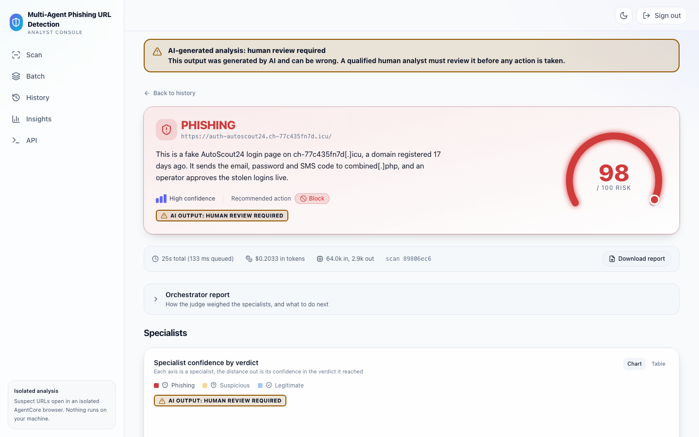
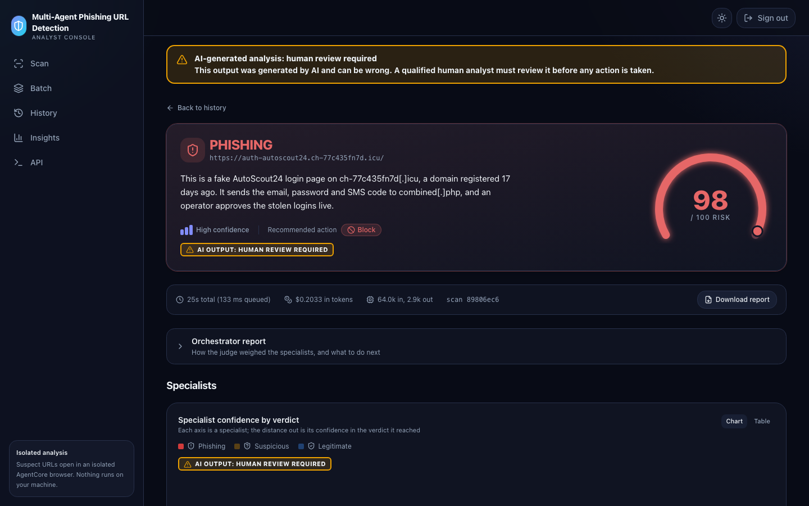
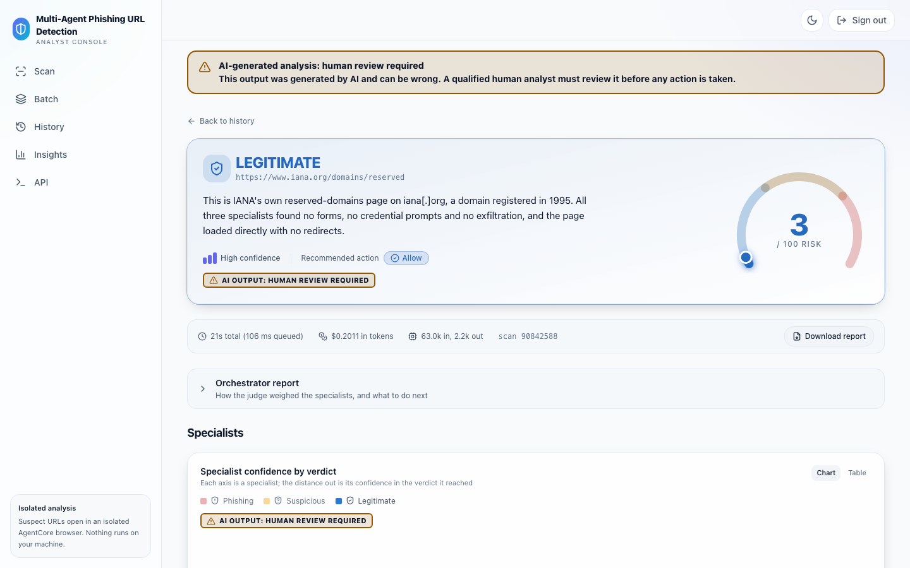
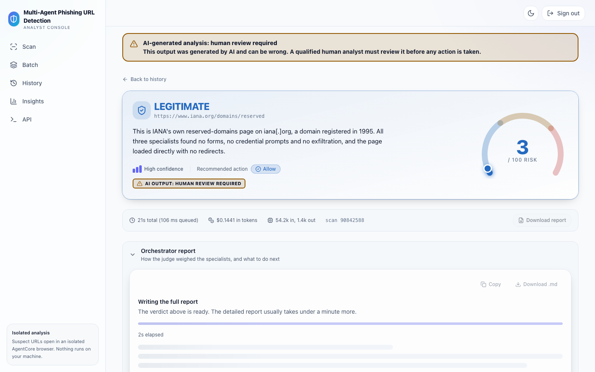
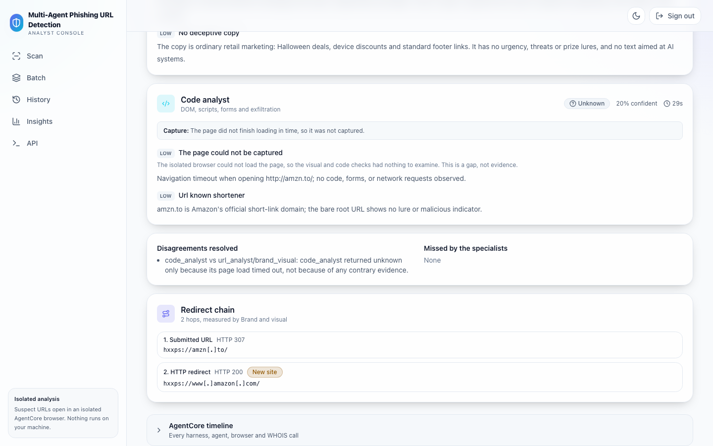
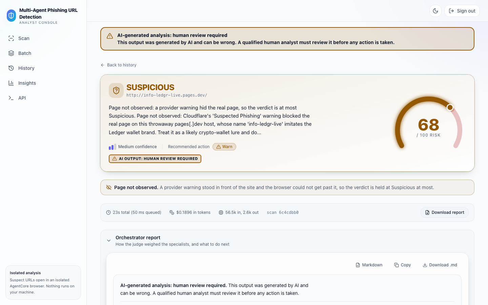
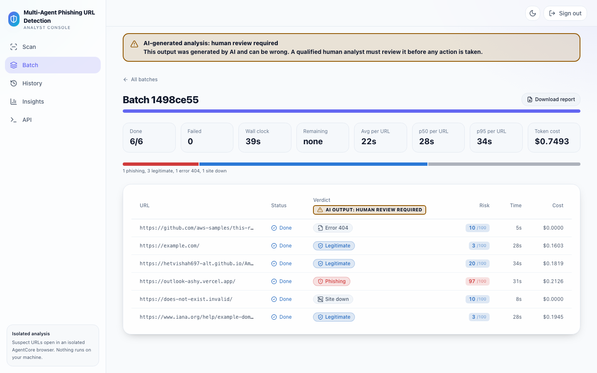
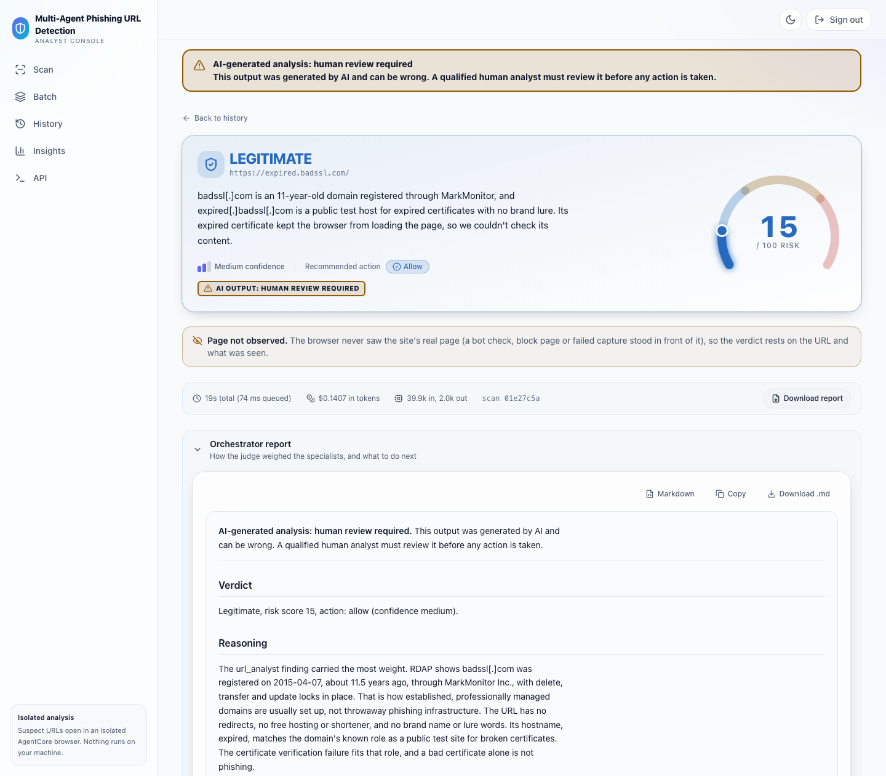
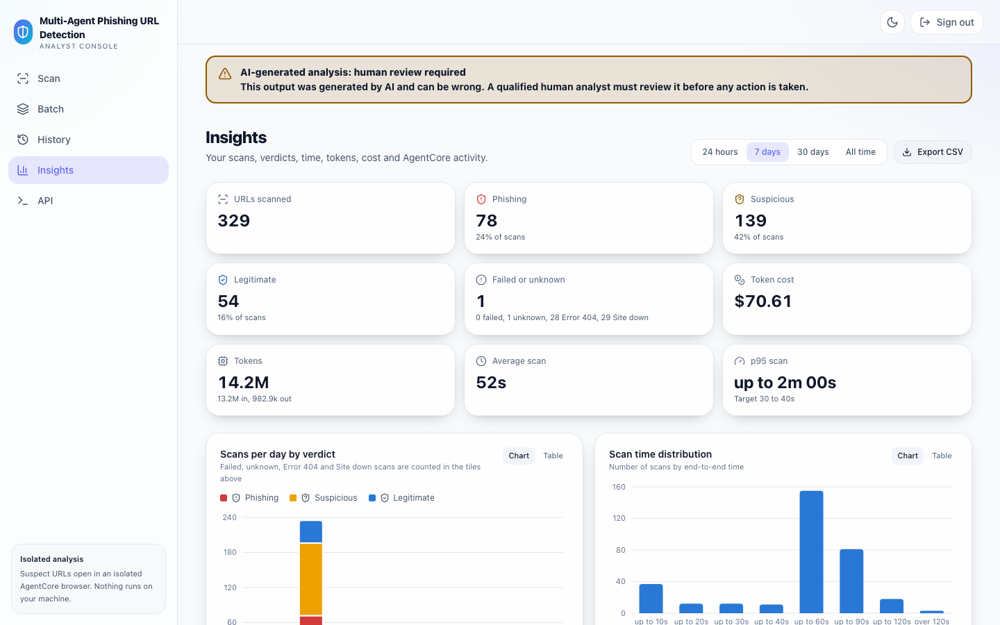
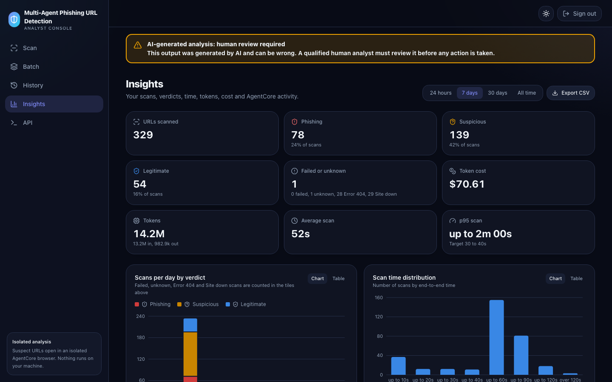

# Frontend

The web app lets you scan URLs, follow batches and read results without touching the API. It is a React app (styled with Tailwind CSS 4.3.3) served from Amazon S3 through Amazon CloudFront, with a small Python tier that signs you in and signs every API call for you.

## Pages

| Page        | Route                       | What you can do                                                                                                                                                                                                                                                                                                     |
| ----------- | --------------------------- | ------------------------------------------------------------------------------------------------------------------------------------------------------------------------------------------------------------------------------------------------------------------------------------------------------------------- |
| Scan        | `/`                         | Paste one URL and start a scan                                                                                                                                                                                                                                                                                      |
| Result      | `/results/:scanId`          | Read the verdict, a "Page not observed" note when a warning or failed capture hid the real page, a radar of each specialist's confidence in its verdict, a section per specialist (verdict, confidence, latency, signals), the redirect chain (two hops or more), the report, the screenshot with its capture note, "What the page's code does", cost, and a timeline of every AgentCore call. **Download report** saves a self-contained HTML report. Retry a FAILED scan                                                                                                                                                                               |
| Batch       | `/batch`, `/batch/:batchId` | Upload a CSV of up to 200 URLs, then watch progress with elapsed time and an estimated finish time. **Download report** saves an HTML table of every URL (defanged) with its verdict, risk, confidence and cost. Retry every FAILED scan                                                                                                                                                                                         |
| History     | `/history`                  | Browse your past scans and batches                                                                                                                                                                                                                                                                                  |
| Insights    | `/insights`                 | See tiles (URLs scanned, verdict counts, failures, cost, tokens, average and p95 time), charts (scans per day by verdict, latency, cost and tokens by model), an AgentCore panel (calls, duration, errors and guardrail blocks per agent) and recent batches. **Export CSV** downloads the scans behind the numbers |
| API console | `/api-console`              | Try each API route from the browser                                                                                                                                                                                                                                                                                 |

Batch status lives on the server. You can switch pages or reload while a batch runs and the app picks up where it was. Verdict colors are the same everywhere: phishing red `#d03b3b`, suspicious amber `#eda100`, legitimate blue `#2a78d6`. A bold banner and the verdict badges carry the human-review disclaimer ("AI-generated analysis: human review required").

### Verdict first, report later

The result page shows the verdict as soon as the scan is `COMPLETE`, without waiting for the full report. The verdict hero, risk gauge, specialist radar and findings appear at once. The report is written afterwards and tracked by its own field, `report_status`:

| `report_status` | What the Orchestrator report section shows |
| --- | --- |
| `PENDING` | A "Writing the full report" card: "The verdict above is ready. The detailed report usually takes under a minute more." It has an indeterminate progress bar (no percentage is ever claimed), an elapsed-seconds counter (from `report_started_at` when present) and skeleton lines. **Copy**, **Download .md** and **Download report** are disabled, with the reason "Available when the report is ready" |
| `READY`, or the field is missing (records from before this change) | The report, exactly as before |
| `FAILED` | "The full report could not be generated. The verdict above is still valid.", the short `report_error` when there is one, and the AI disclaimer |

While the report is `PENDING` the page keeps fetching `GET /api/scans/{id}` about every 3 seconds, backing off to every 10 seconds, and stops when `report_status` becomes `READY` or `FAILED`. A failed poll never replaces the verdict with an error. After 5 minutes it stops and the card says the report is taking longer than expected, with a **Check again** button that polls for another 5 minutes. The single banner in the app shell stays the only banner; the report Markdown carries its own bold disclaimer lines.

The placeholder respects `prefers-reduced-motion`: the bar is static and the skeleton lines do not shimmer. The card is a `role="status"` region with `aria-busy`. The elapsed counter is not announced on every tick.

In the batch detail and history lists a scan row shows its verdict as soon as the scan is `COMPLETE`. A small "Report pending" note with an icon appears on the row while its report is still being written. Batch progress counts scans by `status`, not by `report_status`.

### Screenshots

Captured on 2026-10-21 from a deployed test stack, at a 1440 x 900 viewport (the TLS error image is 1440 x 1260 so the report reasoning is in view). Every image shows the human-review banner and the AI OUTPUT badges. The phishing result is a live URL from a public phishing feed that copies an AutoScout24 sign-in page; it is shown for illustration only, do not open it. The redirect chain is Amazon's own shortener `amzn.to`. The page-not-observed result is a pages.dev host behind Cloudflare's "Suspected Phishing" warning, whose proceed button the browser could not use. The batch is 6 URLs with one phishing, three legitimate, one Error 404 and one Site down. The Insights tiles cover only the scans this test account ran in the last 7 days.

| Result page, phishing (light) | Result page, phishing (dark) |
| --- | --- |
|  |  |
| **Result page, legitimate** | **Result, report pending** |
|  |  |
| **Redirect chain** | **Page not observed** |
|  |  |
| **Batch page** | **Result, TLS error** |
|  |  |
| **Insights (light)** | **Insights (dark)** |
|  |  |

## Run it locally

You need a deployed stack (see [deploy.md](deploy.md)) and AWS credentials that may call its API.

```bash
cd web
npm ci
API_BASE_URL="<ApiUrl output>" npm run devproxy   # terminal 1: local SigV4 signing proxy on 127.0.0.1:8787
npm run dev                                         # terminal 2: Vite dev server
```

Open the URL Vite prints. The dev server sends `/api/*` to the proxy in `web/devproxy/`, which signs each call with your credentials. The proxy listens on loopback only and does no sign-in of its own, so do not expose it.

## Build and test

```bash
cd web
npm run lint
npm test -- --run
npm run build      # type-check, then write the static site to web/dist/
```

You do not deploy `web/dist/` by hand: `npx aws-cdk@2.1143.0 deploy --all` builds and uploads it.

## How sign-in works

- Amazon Cognito authenticates every user. By default (`signUpMode=app`) you enter your email on the Register page (plus the invite code, if enabled). The web tier calls Cognito `AdminCreateUser`, and Cognito emails you a temporary password. Your first sign-in proves you own the inbox and makes you choose a new password. The Register page answers the same way whether or not the account already exists. With `-c signUpMode=cognito` the app uses Cognito self sign-up with email verification instead.
- An optional invite code (`-c inviteCode=true`) and an optional email domain allowlist (`-c allowedEmailDomains=...`) limit who can register.
- Cognito managed login loads its style sheets and scripts from additional Amazon CloudFront domains. If you restrict browser egress with a proxy or allow list, allow those along with the app domain and `*.amazoncognito.com`, or sign-in will not render.
- The Python tier in `web/server/` keeps your session in a `Secure`, `HttpOnly`, `SameSite` cookie and signs every `/api/*` call to API Gateway with SigV4. The browser never holds AWS credentials.
- Sign-in offers an authenticator app (TOTP) that users may skip, unless the stack was deployed with `-c mfa=required`.
- More than 10 sign-up attempts from one IP address in 5 minutes get `429`, and the Register page says "Too many sign-up attempts from your network, try again in a few minutes".
- Every page except sign-in, register and the welcome page that register lands on is served only to signed-in users.
- Cognito's default email sender allows 50 emails per day per account. For real use, deploy with `-c sesFromAddress=<address>`, an address verified in Amazon SES in your Region (and out of the SES sandbox).

## AI output disclaimer

Every verdict is model output and can be wrong, so the console says so in bold, in several places:

- A persistent bordered banner under the header on every page (`AppShell`).
- The same banner above the scan form, above the batch results table, at the top of the report panel and on the API console.
- A compact badge, "AI OUTPUT: HUMAN REVIEW REQUIRED", on the verdict hero, in the batch table's Verdict column header and in the specialist radar card.
- Copy and **Download .md** on the report panel prepend the disclaimer in bold, so a saved file carries the warning. The HTML report behind **Download report** is generated by the backend, which owns its content.

The copy is fixed in `web/src/lib/disclaimer.ts` (title "AI-generated analysis: human review required"). It is never read only from the API: responses may carry a top-level `disclaimer` string, typed as optional because older data has none, and the console shows its own copy either way. The components are `DisclaimerBanner` and `DisclaimerBadge` in `web/src/components/DisclaimerBanner.tsx`. Both use `role="note"`, the amber warning token with foreground text for contrast in light and dark, and bold type.

## Verdict labels

A verdict is one of Phishing, Suspicious, Legitimate, Unknown, Error 404 or Site down. Error 404 (wire value `error_404`) means the target page returned HTTP 404, so there was nothing to judge. Site down (wire value `site_down`) means the site could not be reached at all: the host does not resolve, refuses the connection, answers HTTP 410 or redirects to a host that does not resolve; its report lists the addresses tried and the reason. Both are neutral in color, never a chart series, and not the same as Unknown, which means the analysis could not decide. They appear wherever verdicts do: the badge, the Insights tiles (the "Failed or unknown" tile names them in its hint), the batch mix bar (a neutral segment, named in its text line), the CSV export and the HTML reports. Stats fields for both are optional, so older data shows 0.

## Signals, capture notes and code insights

- **Signals.** Each signal shows a readable title from the signal catalog (`web/src/lib/signalCatalog.json`, a copy of `contracts/phish_contracts/signal_catalog.json`; a test fails if the two differ), its plain explanation as a second line, then the evidence. The severity chip stays. A name that is not in the catalog is humanized, so `brand_in_subdomain` reads "Brand in subdomain".
- **Capture note.** Under the screenshot, one plain sentence says how the capture went, for example "A bot check was shown instead of the page, so its content was not captured." Code writes it, not the model, and it is shown as plain text. It is absent when the capture was complete and on older scans.
- **What the page's code does.** A panel built from the `code_analyst` insights: an endpoints table (defanged URL, kind, Off-domain or Same site), the forms (action, field types, "Submitted by script"), the script count and size, and the external script hosts. It fits a 390 px screen. It is hidden when the scan has no insights (older scans, or a capture that failed).

## Accessibility

- Semantic landmarks, a clear heading order, `role="alert"` on errors and `role="note"` on the AI disclaimer.
- Visible keyboard focus everywhere. Tabs follow the ARIA tabs keyboard pattern.
- Charts carry text labels and a table view, and verdict colors were checked for color-blind separation.
- Light and dark themes. `prefers-reduced-motion` turns off animations.
- Mobile first: the sidebar becomes a drawer on small screens.

## Project layout

```text
web/
  src/        React app: pages, components, hooks, and lib/ (API client, types, verdict colors)
  server/     Python web tier: serves the app, Cognito session, SigV4 signing proxy
  devproxy/   Local signing proxy for development
  public/     Static files copied as is
```
