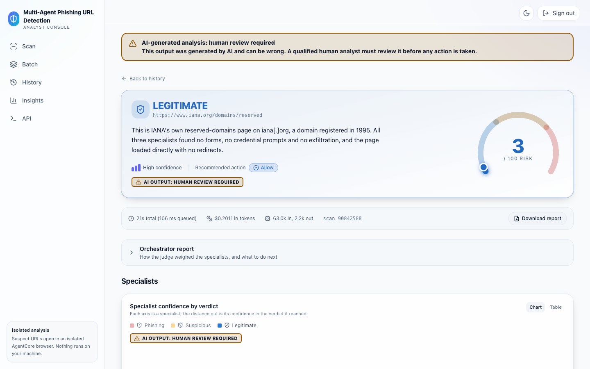
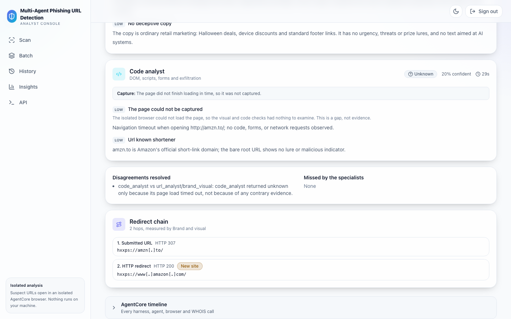
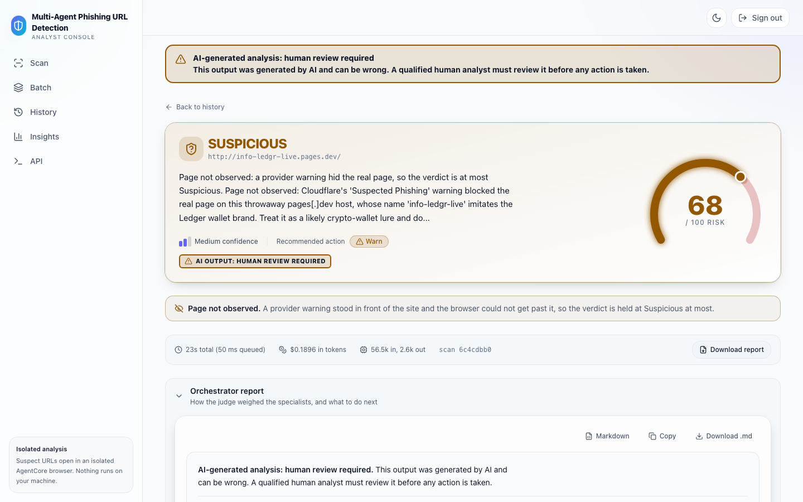
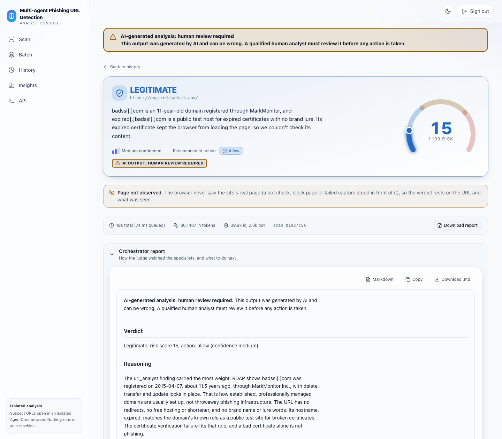
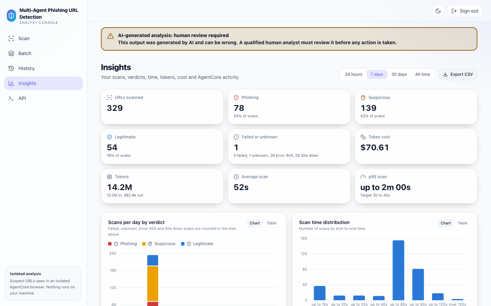
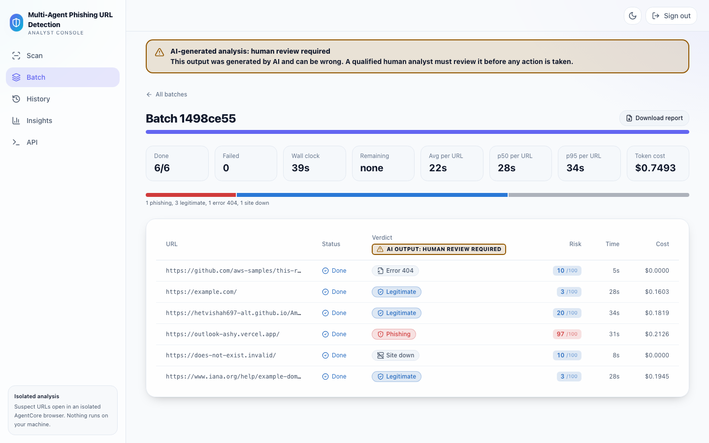

# Getting started

From an empty AWS account to your first verdict, your first API call and a clean teardown. Everything runs in your own account, in the Region you choose. Deploy details and every option: [deploy.md](deploy.md) and [configuration.md](configuration.md).

**On this page:** [Prerequisites](#prerequisites) · [Deploy](#deploy) · [Your first scan](#your-first-scan) · [Test the API](#test-the-api-a-pre-publish-gate) · [Scan many URLs](#scan-many-urls) · [Clean up](#clean-up)

## Prerequisites

| You need                                                       | Check                                                                                |
| -------------------------------------------------------------- | ------------------------------------------------------------------------------------ |
| AWS credentials for your account                               | `aws sts get-caller-identity`                                                        |
| Node.js 22                                                     | `node --version`                                                                     |
| Python 3.13 and uv                                             | `uv --version`                                                                       |
| Finch or Docker, with ARM64 builds                             | `finch version` or `docker version`                                                  |
| Amazon Bedrock access to Claude Opus 5.5 and Claude Sonnet 5.5 | `uv run python scripts/preflight.py --profile <your-profile> --region <your-region>` |
| For the API examples: `awscurl` (`uv tool install awscurl==0.45`) and `jq` | `awscurl --version` and `jq --version`                                         |

## Deploy

1. **Clone** the repository:

   ```bash
   git clone https://github.com/aws-samples/sample-agentic-phishing-detection.git
   cd sample-agentic-phishing-detection
   ```

2. **Install** the Python workspace and run the preflight check:

   ```bash
   uv sync --all-packages
   export AWS_REGION=<your-region>
   uv run python scripts/preflight.py --profile <your-profile> --region "$AWS_REGION"
   ```

3. **Bootstrap** AWS CDK in your Region and in `us-east-1`, once per account. The application deploys to your Region. One small stack, `PhishTriageAgenticEdge`, goes to `us-east-1` because AWS requires the AWS WAF web ACL for CloudFront to be created there. If your Region is `us-east-1`, one bootstrap covers both:

   ```bash
   npx aws-cdk@2.1143.0 bootstrap aws://<account-id>/$AWS_REGION aws://<account-id>/us-east-1
   ```

4. **Deploy** (about 8 minutes the first time, measured in our test account; see [docs/deploy.md](deploy.md#3-deploy-about-8-minutes)):

   ```bash
   cd infra
   export CDK_DOCKER=finch   # or docker
   npx aws-cdk@2.1143.0 deploy --all -c owner=<team or alias>
   ```

   `owner` becomes the `Owner` tag on every resource, so cost shows up against you in Cost Explorer.

5. **Sign up**: open the `WebUrl` stack output, enter your email on the Register page, and sign in with the temporary password Cognito emails you. You choose a new password at first sign-in, which proves you own the inbox. An authenticator app (TOTP) is offered and optional unless you deployed with `-c mfa=required`.

## Your first scan

1. Sign in and paste a URL on the Scan page, for example `https://www.iana.org/domains/reserved`.
2. Press **Scan**. The page shows each agent's progress.
3. Read the verdict and the evidence as soon as they appear. The report panel shows a progress note until the full report is ready. Expect **Legitimate**.



## Test the API: a pre-publish gate

The API is the same one the web app uses. Every route except `GET /health` needs an AWS SigV4 signature. Cognito gates only the web console, not the API. A typical use is a pre-publish gate: submit a URL, poll until the verdict is stored, then decide.

> **Warning:** The verdict is advisory. A gate should hold a risky link for a person to review, not reject it on its own.

How a gate should read the answer:

| The scan says                                | What the gate does                                                                                                                       |
| -------------------------------------------- | ---------------------------------------------------------------------------------------------------------------------------------------- |
| `status` `FAILED`                            | Hold the link and send it to human review                                                                                                |
| `action` `block`, or `risk_score` 70 or more | Hold the link and send it to human review                                                                                                |
| `action` `warn` (Suspicious or Unknown)      | Send it to human review                                                                                                                  |
| `verdict.page_observed` is `false`           | Send it to human review: a provider warning, bot check or failed capture hid the real page. Behind an unpassed provider warning the verdict is capped at Suspicious, risk 69, so a risk threshold alone lets it through |
| `action` `allow` and `page_observed` is not `false` | Publish                                                                                                                           |

1. Read two stack outputs and attach the invoke policy to the IAM role or user you call with. The stack is `PhishTriageAgentic`, or `<Name>TriageAgentic` if you deployed with `-c appName=<name>`:

   ```bash
   export STACK=PhishTriageAgentic   # or <Name>TriageAgentic
   out() { aws cloudformation describe-stacks --stack-name "$STACK" \
     --query "Stacks[0].Outputs[?OutputKey=='$1'].OutputValue" --output text; }
   export API=$(out ApiUrl); export API=${API%/}
   aws iam attach-role-policy --role-name <your-role> --policy-arn "$(out ApiInvokePolicyArn)"
   # or: aws iam attach-user-policy --user-name <your-user> --policy-arn "$(out ApiInvokePolicyArn)"
   ```

2. Submit a scan and poll it. `awscurl` signs with the credentials your AWS CLI already uses:

   ```bash
   id=$(awscurl --service execute-api --region "$AWS_REGION" -X POST "$API/scan" \
     -H 'Content-Type: application/json' -d '{"url": "https://example.com"}' | jq -r .scan_id)
   until awscurl --service execute-api --region "$AWS_REGION" "$API/scans/$id" > scan.json &&
     jq -e '.status == "FAILED" or .status == "COMPLETE"' scan.json > /dev/null
   do sleep 3; done
   jq '{status, verdict: .verdict.verdict, risk: .verdict.risk_score, action: .verdict.action, page_observed: .verdict.page_observed}' scan.json
   ```

   `status` turns `COMPLETE` as soon as the verdict is stored, so a gate does not need to wait for the full report (`report_status` `READY`).

3. Or run the gate in Python with botocore and requests (`uv run --with boto3==1.43.105 --with requests==2.34.2 python gate.py https://example.com`, the versions this repository locks):

   `gate.py`: exit 0 to publish, 1 to hold for review.

   ```python
   """Pre-publish gate: exit 0 to publish, 1 to hold the link for human review."""

   import json
   import os
   import sys
   import time

   import boto3
   import requests
   from botocore.auth import SigV4Auth
   from botocore.awsrequest import AWSRequest

   API, REGION, THRESHOLD = os.environ["API"].rstrip("/"), os.environ["AWS_REGION"], 70
   credentials = boto3.Session(region_name=REGION).get_credentials()


   def call(method: str, path: str, body: dict | None = None) -> dict:
       data = json.dumps(body).encode() if body is not None else None
       request = AWSRequest(method, API + path, data=data, headers={"Content-Type": "application/json"})
       SigV4Auth(credentials, "execute-api", REGION).add_auth(request)
       response = requests.request(method, API + path, data=data, headers=dict(request.headers), timeout=30)
       response.raise_for_status()
       return response.json()


   scan_id = call("POST", "/scan", {"url": sys.argv[1]})["scan_id"]
   while (scan := call("GET", f"/scans/{scan_id}"))["status"] not in ("COMPLETE", "FAILED"):
       time.sleep(3)
   verdict = scan.get("verdict") or {}
   print(scan["status"], verdict.get("verdict"), verdict.get("risk_score"), verdict.get("action"))
   review = (
       scan["status"] == "FAILED"
       or verdict.get("action") in ("block", "warn")
       or verdict.get("risk_score", 0) >= THRESHOLD
       or verdict.get("page_observed") is False
   )
   sys.exit(1 if review else 0)
   ```

### What to expect

| You submit                                                                              | You get                                                                                                                                                                                                                           |
| --------------------------------------------------------------------------------------- | --------------------------------------------------------------------------------------------------------------------------------------------------------------------------------------------------------------------------------- |
| `https://example.com`                                                                   | `COMPLETE`, verdict `legitimate`, a low risk score, action `allow`                                                                                                                                                                |
| A host that does not exist, for example `https://does-not-exist.invalid/`               | `site_down`, risk 10, action `allow`, report ready at once, no findings, `cost_usd` `0`                                                                                                                                           |
| A host whose certificate the browser rejects, for example `https://expired.badssl.com/` | The host is up, so never `site_down`: the findings carry a `tls_error` capture gap, which lowers confidence but is not evidence on its own                                                                                        |
| A `www.` link whose certificate does not cover the `www.` name (`ERR_CERT_COMMON_NAME_INVALID`) | The browser opens the same site without `www.` once, through the same URL guard. That page is evidence about the same operator, but the submitted page was not seen (visitors get a certificate warning): the findings carry `tls_error` and `www_sibling_capture`, `page_observed` is `false`, and the verdict is at most Suspicious (risk at most 69, action `warn`) |
| A link that redirects, for example a shortener                                          | Every hop is checked and recorded in `redirect_chain`; a throwaway host that only bounces to a brand's sign-in page is judged phishing                                                                                            |
| A page behind a Cloudflare "Suspected Phishing" or "Suspected Malware" warning          | The browser clicks the warning's own proceed button once, only when Cloudflare has enabled it. If the real page is not reached, the verdict is at most Suspicious (risk at most 69, action `warn`) and `page_observed` is `false` |
| A captured copy of a brand's sign-in or landing page with a sign-in, sign-up, account, payment or wallet action, on a domain the brand does not own, even a "clone" or "demo" whose buttons send nothing | At least Suspicious, risk 50 or more, action `warn`: kits are often wired up after a page is published. Phishing when the domain is built from the brand or the copy claims to be official, and it offers a sign-in, account or wallet action. Brand documentation with no such action is judged on the evidence |
| A page the browser cannot load (a time-out, a browser refusal or a browser error) | `code_analyst` reads the page's raw HTML once through the guarded HTTP probe and never runs it. When that returns an HTML page, it adds a `static_html_only` capture gap, and its Finding has `page_observed: false` |
| An unsigned request, or a principal without the invoke policy                           | `403`                                                                                                                                                                                                                             |
| Too many requests                                                                       | `429`: retry with backoff                                                                                                                                                                                                         |

| **Redirect chain**: every hop, checked and flagged | **Page not observed**: held at Suspicious for review |
| --- | --- |
|  |  |
| **Certificate error**: a capture gap, not a dead site | **Insights**: volume, verdicts, time and cost |
|  |  |

Every response except `GET /health` carries a top-level `disclaimer` field, and URLs in model-written text are defanged (`hxxps://example[.]com`) so no stored report holds a live link. Routes, fields and errors: [docs/api.md](api.md).

### How long a scan takes

| Scenario (test stack, `us-west-2`) | To the verdict | Source |
| --- | --- | --- |
| Current default, 448 URLs submitted at once, `scanConcurrency` 25 (2026-11-03) | Median 18.6 s, p90 31.2 s from worker start; median 325 s from submit, because most of that is queue wait at 25 scans in flight | [evaluation.md](evaluation.md#latency-flags-on-by-default-2026-11-03) |
| Dead or HTTP 404 URL, answered by the pre-check (2026-10-18) | 1.0 to 6.7 s | [evaluation.md](evaluation.md#current-design) |

The report follows the verdict; it was not timed on its own on the current default. Earlier designs are in [evaluation.md](evaluation.md#latency-history).

## Scan many URLs

**In the web app**, open Batch and upload a CSV of up to 200 URLs. The first column is the URL and a header row is optional. Blank lines and duplicates are dropped, and invalid rows are listed after upload. You can leave the page or reload it: the batch keeps running and its status comes back.

**With the API**, send up to 50 URLs as JSON, or upload a CSV of up to 1,000:

```bash
awscurl --service execute-api --region "$AWS_REGION" -X POST "$API/batches" \
  -H 'Content-Type: application/json' -d '{"upload": true, "count": 1000, "source": "api"}' > slot.json
args=(); while IFS= read -r kv; do args+=(-F "$kv"); done < <(jq -r '.upload_fields | to_entries[] | "\(.key)=\(.value)"' slot.json)
curl -sS "${args[@]}" -F "file=@urls.csv" "$(jq -r .upload_url slot.json)"
```

Then poll `GET /batches/{id}` with the `batch_id` from `slot.json`. Every URL ends `COMPLETE` or `FAILED` with a reason, and you can retry failures. See [docs/api.md](api.md#scan-up-to-1000-urls-from-a-csv).



> **Tip:** `-c scanConcurrency` (default 25) trades batch throughput against the time each scan takes. More scans at once finish a batch sooner but each one waits longer on the orchestrator model. Lower it, for example to 10, if single-scan latency matters more.

## Clean up

> **Warning:** The stacks cost about $14 to $15 per month even when you run no scans (estimate for `us-west-2` from AWS list prices, checked 2026-10-18; Cost Explorer for the tagged stacks agreed over 2026-10-15 to 2026-10-18; breakdown in [cost.md](cost.md)). Delete them when you are done. This deletes the stored scans and every Cognito user.
>
> A stack deployed with `-c environment=prod` uses the `RETAIN` removal policy: `destroy` deletes the stacks but leaves the tables, buckets, user pool, keys and agents, with their data. See [docs/deploy.md](deploy.md#clean-up) to remove them.

```bash
cd infra
npx aws-cdk@2.1143.0 destroy --all
# a second copy deployed with -c appName=<name>: pass the same flag
npx aws-cdk@2.1143.0 destroy --all -c appName=<name>
```

A few things stay behind and are yours to remove:

| Left behind                                                                                           | How to remove it                              |
| ----------------------------------------------------------------------------------------------------- | --------------------------------------------- |
| The orchestrator harness log group (`/aws/bedrock-agentcore/`, with `<appName>_orchestrator`, by default `phish_orchestrator`, in its name) | Delete it by hand |
| The orchestrator's former managed memory, only on a stack first deployed before 2026-10-16            | See [docs/deploy.md](deploy.md#clean-up) |
| CDK bootstrap stacks (`CDKToolkit`) in your Region and `us-east-1`                                    | Keep them if you use CDK elsewhere            |
| Log groups of the CDK helper Lambdas (`/aws/lambda/<Name>TriageAgentic-*`, untagged)                  | Delete them by hand                           |
| Container images in the CDK asset repository in Amazon ECR                                            | Delete them, or remove the bootstrap stack    |

Check that nothing tagged for this sample is left. Both commands should return an empty `ResourceTagMappingList` (the tagging index can list a deleted resource for a while after `destroy`; describe it to confirm):

```bash
aws resourcegroupstaggingapi get-resources --tag-filters Key=Project,Values=phish-triage --region "$AWS_REGION"
aws resourcegroupstaggingapi get-resources --tag-filters Key=Project,Values=phish-triage --region us-east-1
```

The `Project` tag is the same for every copy of the sample. If another copy still runs in the account, check one copy by its stack name instead (`PhishTriageAgentic`, or `<Name>TriageAgentic` for `-c appName=<name>`):

```bash
aws resourcegroupstaggingapi get-resources --tag-filters Key=aws:cloudformation:stack-name,Values=<Name>TriageAgentic --region "$AWS_REGION"
aws resourcegroupstaggingapi get-resources --tag-filters Key=aws:cloudformation:stack-name,Values=<Name>TriageAgenticEdge --region us-east-1
```

